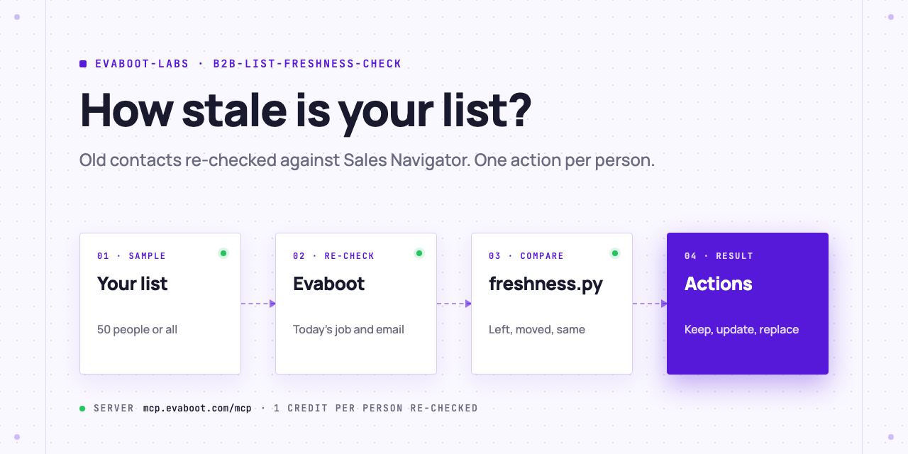
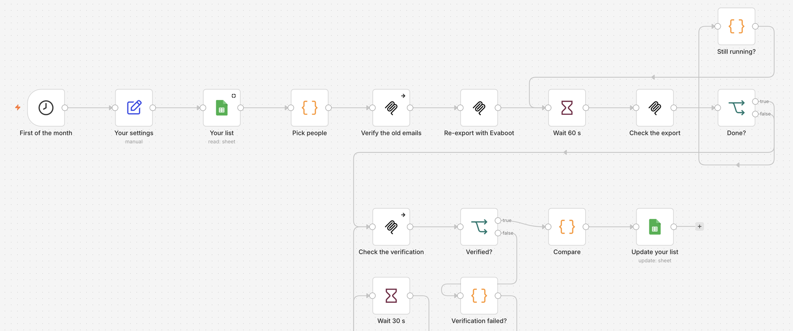

<picture>
  <source media="(prefers-color-scheme: dark)" srcset=".github/assets/banner-dark.png">
  
</picture>

# B2B list freshness check

A contact list is a snapshot: the day you export or buy it, it starts to age. Your AI Agent re-checks a sample of your list (or all of it) against LinkedIn Sales Navigator through Evaboot, verifies the old emails, and tells you who still holds the same job, who changed title, who left, and which emails to fix, with one action per person.

[](AGENTS.md)
[](https://evaboot.com/mcp)
[](LICENSE)

## Set it up in one prompt

Paste this into Claude Code, Codex or Cursor:

```text
Clone https://github.com/evaboot-labs/b2b-list-freshness-check, read AGENTS.md and follow the skill. Check how fresh my oldest Evaboot export is, on a sample of 50 people.
```

<details>
<summary>Or install the skill</summary>

Claude Code:

```text
/plugin marketplace add evaboot-labs/b2b-list-freshness-check
/plugin install b2b-list-freshness-check@evaboot-labs-b2b-list-freshness-check
```

Codex, Cursor and other agents:

```bash
npx skills add evaboot-labs/b2b-list-freshness-check
```

</details>

## How it works

**1. Pick the people.** `freshness.py sample` takes 50 people at random from an old Evaboot export or a CSV with Sales Navigator URLs. Use the whole list to clean every row.

**2. Re-check them today.** Your agent re-exports the same people from Sales Navigator with Evaboot, and verifies the emails the old list holds.

**3. Compare and act.** `freshness.py compare` sorts each person into same job, new title, left the company or not found, and writes one action per row. We ran it on a list exported in April 2026, six and a half months later:

```text
50 people re-checked
  same job                        44  (88%)
  new title                        3  (6%)
  left the company                 3  (6%)
the old list's emails, verified today (37):
  safe                            31  (84%)
  riskier                          6  (16%)
15 of 50 rows (30%) need an update, a replacement or a removal
```

The three people who left still had old addresses that **accept mail**: a list can pass email verification and still reach the wrong person.

**4. Replace who left.** For each departure, the agent finds the company in Sales Navigator and names who holds the role now.

**5. Or run it in n8n.** On the first of every month, the workflow re-checks your Google Sheet and writes the status and action next to each row.



## What you need

- An [Evaboot account](https://dash.evaboot.com/accounts/signup/?last_click_origin=b2b-list-freshness-check-repo) and a Sales Navigator seat.
- A list with a Sales Navigator lead id per person: an Evaboot export, or Sales Navigator URLs in your CRM. Public `linkedin.com/in/` links alone cannot be re-checked.
- An AI Agent that can use an MCP server: Claude Code, Codex, Cursor, or the n8n version.
- Python 3.9+, with no packages to install. Cost: 1 Evaboot credit per person re-checked, plus email verification.

## Go further

| Page | For |
|---|---|
| [docs/connect-your-agent.md](docs/connect-your-agent.md) | The setup by hand, for each agent |
| [docs/n8n.md](docs/n8n.md) | The monthly check in n8n, on a Google Sheet |

---

Agents: start at [AGENTS.md](AGENTS.md) · Built by [Evaboot](https://evaboot.com) · More workflows at [github.com/evaboot-labs](https://github.com/evaboot-labs) · [MIT license](LICENSE)
